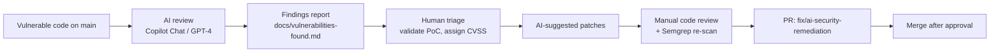

> [!CAUTION]
> **This application is intentionally vulnerable.** It exists for security training and portfolio purposes only. Never deploy it to a public server or run it on a shared network. Bind it to `127.0.0.1` only.

# DevSecOps Vulnerable App: Find & Fix with AI

A small Flask "shop" (**VulnShop**) with eight deliberate, realistic web vulnerabilities. The project shows a full **find → triage → fix → verify** workflow:

1. **`main` branch**: the vulnerable app (`app.py`).
2. **AI-assisted security review**: findings documented in [`docs/vulnerabilities-found.md`](docs/vulnerabilities-found.md) with CWE, CVSS and proof-of-concept exploits.
3. **`fix/ai-security-remediation` branch**: a pull request adding `app_secure.py` with every finding patched, documented in [`docs/fixes-applied.md`](docs/fixes-applied.md).

## Vulnerabilities

| ID | Vulnerability | Location | CWE | OWASP Top 10 (2021) | CVSS 3.1 | Real-world reference |
|----|---------------|----------|-----|---------------------|----------|----------------------|
| VULN-01 | SQL injection (auth bypass) | `POST /login` | [CWE-89](https://cwe.mitre.org/data/definitions/89.html) | A03 Injection | 9.8 Critical | CVE-2023-34362 (MOVEit SQLi) |
| VULN-02 | SQL injection (UNION data theft) | `GET /search` | [CWE-89](https://cwe.mitre.org/data/definitions/89.html) | A03 Injection | 8.6 High | CVE-2023-34362 (MOVEit SQLi) |
| VULN-03 | Reflected cross-site scripting | `GET /search` | [CWE-79](https://cwe.mitre.org/data/definitions/79.html) | A03 Injection | 6.1 Medium | CVE-2020-11022 class (jQuery XSS) |
| VULN-04 | Insecure direct object reference | `GET /user/<id>` | [CWE-639](https://cwe.mitre.org/data/definitions/639.html) | A01 Broken Access Control | 6.5 Medium | 2018 USPS "Informed Visibility" API exposure |
| VULN-05 | Hard-coded secret key | `app.py` | [CWE-798](https://cwe.mitre.org/data/definitions/798.html) | A07 Identification & Auth Failures | 7.5 High | CVE-2022-1471-style session forgery risk |
| VULN-06 | No brute-force protection | `POST /login` | [CWE-307](https://cwe.mitre.org/data/definitions/307.html) | A07 Identification & Auth Failures | 7.5 High | Credential-stuffing campaigns |
| VULN-07 | Debug mode in production | `app.run(debug=True)` | [CWE-489](https://cwe.mitre.org/data/definitions/489.html) | A05 Security Misconfiguration | 9.8 Critical | Werkzeug debugger RCE (CVE-2024-34069) |
| VULN-08 | Missing security headers | all responses | [CWE-693](https://cwe.mitre.org/data/definitions/693.html) | A05 Security Misconfiguration | 4.3 Medium | Clickjacking / MIME sniffing |

> CVE references point to real-world incidents of the **same vulnerability class**. They are not CVEs in this app.

## Run locally

### With Docker (recommended)
```bash
docker build -t vulnshop .
docker run --rm -p 127.0.0.1:5000:5000 vulnshop
# open http://127.0.0.1:5000
```

### Without Docker
```bash
python -m venv .venv && source .venv/bin/activate
pip install -r requirements.txt
python database.py      # seed demo data
python app.py           # vulnerable version (main branch)
```

Demo accounts: `alice / alice-demo-pass`, `bob / bob-demo-pass`. These are fake training credentials.

### Try the exploits
| Attack | How |
|--------|-----|
| Login bypass (VULN-01) | Username `admin' --`, any password |
| Dump users (VULN-02) | `/search?q=' UNION SELECT id, username, password, email FROM users --` |
| XSS (VULN-03) | `/search?q=<script>alert(document.domain)</script>` |
| IDOR (VULN-04) | Log in as bob, then visit `/user/1` |

## AI-assisted security review

The remediation follows a **human-in-the-loop** AI workflow, which is how many security teams now use AI:



1. **Prompt the AI with context.** Example: *"Act as an application security engineer. Review this Flask app for OWASP Top 10 issues. For each finding give the CWE, a CVSS 3.1 score, the vulnerable line and a proof of concept."*
2. **Validate every finding.** Each AI finding was reproduced manually. AI tools produce false positives and sometimes miss issues, such as the `|safe` filter in a template.
3. **Ask for minimal, idiomatic fixes.** These include parameterised queries, Flask-Limiter, Flask-Talisman and environment-based secrets.
4. **Review the AI's code.** AI-suggested fixes can introduce new bugs. Every change was read line by line and re-tested with the original PoC.
5. **Open a PR** using [`.github/pull_request_template.md`](.github/pull_request_template.md), which includes an *AI assistance disclosure* section.

### View the fix
```bash
git checkout fix/ai-security-remediation
pip install -r requirements.txt
export SECRET_KEY="$(python -c 'import secrets; print(secrets.token_hex(32))')"
python app_secure.py
git diff main..fix/ai-security-remediation
```

## Project structure
```
├── app.py                  # Intentionally vulnerable app (main)
├── app_secure.py           # Remediated app (fix/ai-security-remediation branch)
├── database.py             # SQLite schema + demo data
├── templates/              # Jinja2 templates (search.html contains the XSS sink)
├── static/css/style.css
├── docs/
│   ├── vulnerabilities-found.md
│   └── fixes-applied.md
├── .github/pull_request_template.md
└── Dockerfile
```

## Related projects
- **Fintech-Threat-Model**: STRIDE, MITRE ATT&CK and Kill Chain threat model
- **devsecops-cicd-security**: Trivy + Semgrep pipeline that would block `app.py` from merging
- **secure-task-api**: a production-style secure FastAPI app

## Licence
MIT. For educational use only.
